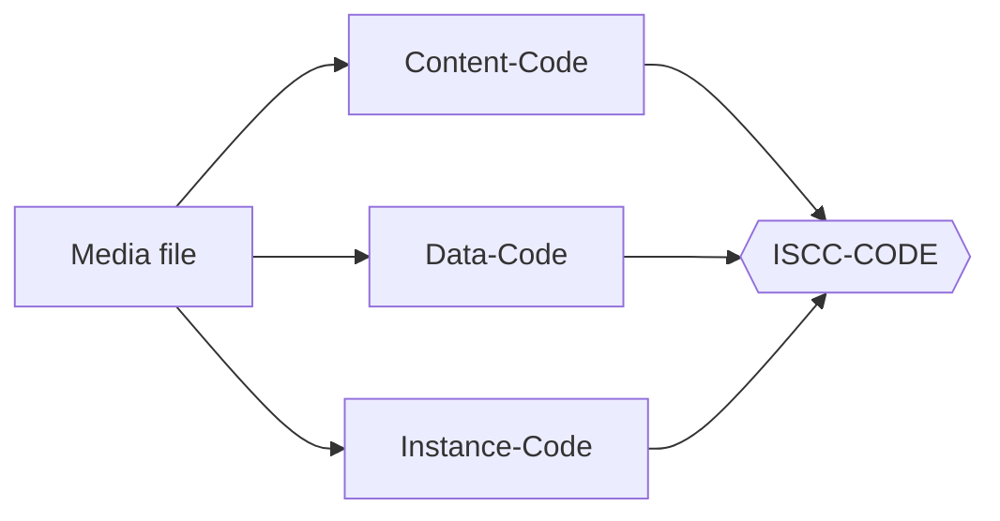
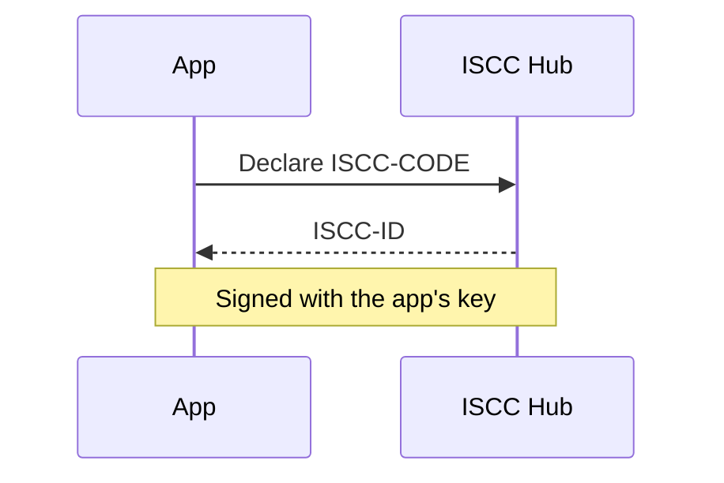

# Components

The theme styles each element on this page. After a change to the theme or to Zensical, look at this page in both
color schemes.

The theme also styles these ISCC components. Do not style them again in the stylesheets of a site.

| Class                                                                 | Use                                                                          |
| --------------------------------------------------------------------- | ---------------------------------------------------------------------------- |
| `.iscc-lead`                                                          | The first paragraph of a page, in a larger size. Add `{ .iscc-lead }` on the line after it |
| `.iscc-btn`, `.iscc-btn--primary`                                     | Call-to-action buttons on links, with space between them in a row: `[Start](start.md){ .iscc-btn .iscc-btn--primary }` |
| `.iscc-cards`, `.iscc-card`                                           | Audience cards, three in a row on wide screens. Each card has an `h3`, text and a last paragraph with one link |
| `.iscc-unit--meta`, `--semantic`, `--content`, `--data`, `--instance` | ISCC-UNIT labels in the colors of their units                                |

Cards need the `md_in_html` extension and blank lines around each block:

```html
<div class="iscc-cards" markdown>

<div class="iscc-card" markdown>

### Developers

Generate ISCC codes from your own code.

[Get started →](start.md)

</div>

</div>
```

## Lead paragraph

The first paragraph of a page, in a larger size. Add `{ .iscc-lead }` on the line after the paragraph.
{ .iscc-lead }

## Calls to action

[Primary action](index.md){ .iscc-btn .iscc-btn--primary }
[Second action](index.md){ .iscc-btn }

## Cards

<div class="iscc-cards" markdown>

<div class="iscc-card" markdown>

### Developers

Generate ISCC codes from your own code with the libraries.

[Get started →](index.md)

</div>

<div class="iscc-card" markdown>

### Registries

Declare content and make it discoverable on the network.

[Declare →](index.md)

</div>

<div class="iscc-card" markdown>

### Operators

Run a service for mainnet or testnet.

[Deploy →](index.md)

</div>

</div>

## Text

Body copy with **strong**, *emphasis*, `inline code`, a [link](index.md) and an abbreviation: ISCC.

*[ISCC]: International Standard Content Code

> A block quote with a single sentence.

Content-Code
:   A definition list entry, here for an ISCC-UNIT.

Footnotes render at the end of the page.[^1]

[^1]: The footnote text.

## ISCC-UNIT labels

<span class="iscc-unit--meta">Meta-Code</span>, <span class="iscc-unit--semantic">Semantic-Code</span>,
<span class="iscc-unit--content">Content-Code</span>, <span class="iscc-unit--data">Data-Code</span> and
<span class="iscc-unit--instance">Instance-Code</span>.

## Admonitions

!!! note

    Note and info are Sky Blue.

!!! tip

    Tip and success are Lime.

!!! warning

    Warning is Yellow.

!!! danger

    Danger is Coral.

??? info "Collapsible"

    Details collapse with `???`.

## Code

```python
import iscc_core as ic

code = ic.gen_meta_code("Title", "Description")
print(code["iscc"])
```

=== "Python"

    ```python
    print("tabbed code")
    ```

=== "Shell"

    ```bash
    echo "tabbed code"
    ```

## Diagrams





## Tables

| Unit     | Header    | Bits |
| -------- | --------- | ---- |
| Meta     | `0000...` | 64   |
| Content  | `0010...` | 64   |
| Instance | `0100...` | 64   |

## Buttons

[Primary](index.md){ .md-button .md-button--primary }
[Secondary](index.md){ .md-button }
