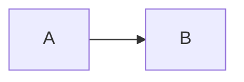

# For Coding Agents

Prescriptive reference for agents. Two audiences: agents that **build a site** on the theme (sections marked
*site*) and agents that **change the theme** in `iscc/zensical-iscc` (marked *theme*). Everything else applies to
both. Full Markdown of this site: [`llms-full.txt`](https://theme.iscc.codes/llms-full.txt).

## Architecture map

### Package layout (*theme*)

| Path                                         | Contains                                                                                   |
| -------------------------------------------- | ------------------------------------------------------------------------------------------ |
| `zensical_iscc/__init__.py`                  | `THEME_DIR`; `THEME`, a `SimpleNamespace` whose `__file__` lies in `theme/`                |
| `zensical_iscc/cli.py`                       | `main(argv)`, `run_build`, `run_markdown`, `run_project_logo`, `run_check`                 |
| `zensical_iscc/project.py`                   | `load_project`, `docs_dir`, `site_dir`, `custom_dir`, `resolve_dir`                        |
| `zensical_iscc/markdown.py`                  | Markdown copies, `llms-full.txt`, `llms.txt`; `AGENT_PAGE`, `agent_page`, `flatten_nav`, `rebase_links`, `local_links` |
| `zensical_iscc/check.py`                     | `check(config_path)` and one `*_findings` function per rule                                |
| `zensical_iscc/project_logo.py`              | `compose`, `write`, `project_name`, `is_valid`; port of the ISCC project logo construction |
| `zensical_iscc/theme/`                       | The theme directory Zensical loads; templates, partials, `assets/iscc/`; no Python         |
| `zensical.toml`, `docs/`                     | theme.iscc.codes and the reference configuration for sites                                 |
| `skills/iscc-docs-theme/SKILL.md`            | Setup, migration and upgrade procedure for sites; `docs-workflow.yml` template             |
| `skills/docs-for-agents/SKILL.md`            | Vendored copy from `titusz/skills`; writes this kind of page                               |
| `skills/.claude-plugin/plugin.json`          | Plugin manifest; plugin root is `skills/`, `version` equals the package version            |
| `scripts/sync_changelog.py`                  | Git hook: `CHANGELOG.md` → `docs/changelog.md` with front matter                           |
| `tests/`                                     | pytest; `docs_config` fixture copies `zensical.toml` + `docs/` and builds for real         |

### Import flow

```
cli → check → markdown, project, project_logo
cli → markdown, project, project_logo
project_logo → zensical_iscc.THEME_DIR, fontTools
```

### Public surface

| Surface                     | Name                                                     | Consumers                       |
| --------------------------- | -------------------------------------------------------- | ------------------------------- |
| Console script              | `zensical-iscc` → `zensical_iscc.cli:main`               | Sites, CI                       |
| Theme entry point           | `mkdocs.themes: zensical_iscc = zensical_iscc:THEME`     | Zensical, `name = "zensical_iscc"` |
| Config table                | `[project.extra.iscc]`, `[project.extra.analytics]`      | `main.html`, partials, `check`  |
| CSS classes                 | `.iscc-lead`, `.iscc-btn`, `.iscc-btn--primary`, `.iscc-cards`, `.iscc-card`, `.iscc-unit--*` | Site pages                      |
| Plugin marketplace          | `zensical-iscc@zensical-iscc`: `iscc-docs-theme`, `docs-for-agents` | Claude Code                     |

## Decision dispatch

### Which command (*site*)

| Goal                                         | Command                                   |
| -------------------------------------------- | ----------------------------------------- |
| Build for deployment or real preview         | `zensical-iscc build`                     |
| Live-reload drafting (no project logo, no `.md`) | `zensical serve --dev-addr 127.0.0.1:<port>` |
| Add Markdown copies to an existing build     | `zensical-iscc markdown`                  |
| Gate CI                                      | `zensical-iscc check --strict`            |
| Config elsewhere                             | add `-f path/to/zensical.toml`            |

### Which setting (*site*)

| Need                                 | Setting                                                         |
| ------------------------------------ | --------------------------------------------------------------- |
| Home page title suffix               | `[project.extra.iscc] tagline`                                  |
| Project logo name differs from `repo_name` minus `iscc-` | `[project.extra.iscc] project`                                  |
| Header "Projects" menu               | `[[project.extra.iscc.related]]` with `name`, `link`, `description` |
| Hide "Copy page"                     | `copy_page = false`                                             |
| Chat widget                          | `chat = true`, only after iscc.ai serves the domain             |
| Link preview image                   | `og_image = "assets/..."`                                       |
| Count analytics under another host   | `[project.extra.analytics] domain`                              |
| Site-specific template               | `[project.theme] custom_dir`, file extends `main.html`          |
| Diagrams                             | Fenced `mermaid` blocks; `custom_fences = [{ name = "mermaid", class = "mermaid" }]` in `[project.markdown_extensions.pymdownx.superfences]` |

### Where a theme change goes (*theme*)

| Change                                   | File                                                         |
| ---------------------------------------- | ------------------------------------------------------------ |
| Colours, spacing, component styles       | `theme/assets/iscc/theme.css` (map tokens; never edit `tokens/`) |
| Head metadata, page-level widgets        | `theme/main.html`                                            |
| Header markup                            | `theme/partials/header.html` (Zensical copy + one include)   |
| Footer content, shared ISCC links, social links | `theme/partials/copyright.html`                              |
| Default features, palette                | `theme/mkdocs_theme.yml`                                     |
| A library the bundle loads from unpkg.com | Copy in `theme/assets/iscc/vendor/`, loaded in the `libs` block of `main.html` only on pages that need it |
| New configuration rule                   | `check.py` new `*_findings` + call in `check()`              |
| New build output                         | `cli.run_build` chain + `check` presence finding             |

## Constraints and invariants

| Constraint                                                                 | Why                                                         |
| -------------------------------------------------------------------------- | ----------------------------------------------------------- |
| No Python file under `zensical_iscc/theme/`                                | Zensical copies every non-template file into the site       |
| One pinned Zensical version in `pyproject.toml`                            | Templates override Zensical's                               |
| Pages load nothing from other origins except `stats.iscc.codes`, `iscc.ai` | Privacy promise; `check.ALLOWED_HOSTS`                      |
| Project name matches `[a-z0-9]+(-[a-z0-9]+)*`, does not start with `iscc`  | `project_logo.is_valid`; invalid explicit `project` is an error |
| `project_logo.compose` output equals `tests/fixtures/project-logos/*.svg`  | Byte fidelity with the reference SVGs; keep arithmetic order |
| Coordinates formatted by `project_logo.fmt`, two decimals                  | Fidelity                                                    |
| `nav` is directly under `[project]`, before any subtable                   | TOML scopes keys into the last table header                 |
| Listing Markdown extensions replaces Zensical's defaults                   | The list must be complete                                   |
| `for-coding-agents.md` exists and is in `nav`, last                        | `check.agent_page_findings` warns; fails under `--strict`   |
| Directory URLs: page `a/b.md` → `site/a/b/index.md`                        | `markdown.output_path`; the `<link rel="alternate">` relies on it |
| Copies rewrite relative links that resolve to a docs file; code and other links stay | `markdown.rebase_link`; `check.markdown_link_findings` warns on links that resolve to nothing |
| `theme.css` overrides match Zensical's selector specificity                | Lower specificity loses silently (see mistakes)             |
| `--md-mermaid-*` colors are set on `:root > *`, Zensical's selector        | Its sequence diagram variables derive from them there       |
| `main.html` loads `vendor/mermaid/mermaid.min.js` iff the content has `<pre class="mermaid` | The bundle renders `pre.mermaid`; `check.page_findings` flags a diagram without `check.MERMAID_SCRIPT` |
| On diagram pages `main.html` loads GLightbox, Mermaid, then `diagramzoom.js`, all before the bundle | `diagramzoom.js` wraps `mermaid.render`: the bundle draws into closed shadow roots and hands each to `bindFunctions`; `test_bundle_hands_each_diagram_to_bind_functions` |
| Vendored Mermaid major equals the `mermaid@` major in the Zensical bundle  | The bundle drives that API; `test_vendored_mermaid_matches_the_bundle` |
| Content width capped at 1385px; root font size held at 125%                | Layout and type scale                                       |
| Templates run on MiniJinja                                                 | Attribute access on undefined raises; guard with `or {}`    |

## Side effects catalog

| Call                              | Writes                                                                          | Exit / return               |
| --------------------------------- | ------------------------------------------------------------------------------- | --------------------------- |
| `cli.run_build`                   | Zensical build (clean), then everything below                                   | First non-zero step code    |
| `cli.run_markdown`                | `site/**/index.md`, `site/llms-full.txt`, `site/llms.txt`                       | 1 if `site/` is missing     |
| `cli.run_project_logo`            | `site/assets/iscc/project-logo.svg` (white-coral, 1 h = 24px)                   | 1 for an invalid name; 0 and a note without a name |
| `cli.run_check`                   | Nothing; prints findings and a count                                            | 1 on errors, or on warnings with `--strict` |
| `markdown.write_pages`            | One `index.md` per page, front matter stripped, links rebased; both llms files  | None                        |
| `project_logo.write`              | Creates `assets/iscc/` if needed                                                | Path written                |
| `scripts/sync_changelog.py`       | `docs/changelog.md`                                                             | 1 when it changed the file  |
| `project_logo.signature_geometry`, `face` | Cached (`functools.cache`) per process                                          | -                           |

## Task recipes

### Put a site on the theme (*site*)

1. Follow `skills/iscc-docs-theme/SKILL.md`; it covers survey, questions for the human, dependency, config, cleanup,
    CI and verification.
1. Dependency: `docs = ["zensical-iscc"]` and
    `zensical-iscc = { git = "https://github.com/iscc/zensical-iscc", tag = "vX.Y.Z" }` in `[tool.uv.sources]`.
1. Copy this repository's `zensical.toml`; replace values marked `# site`.
1. Every page: `icon: lucide/<name>` and `description:` in front matter.
1. Write `docs/for-coding-agents.md` with `/zensical-iscc:docs-for-agents create`; add
    `{ "For Coding Agents" = "for-coding-agents.md" }` as the last `nav` entry.
1. `uv run zensical-iscc build && uv run zensical-iscc check --strict` → `0 errors, 0 warnings`.

### Add a check (*theme*)

```python
def thing_findings(config):
    # type: (dict) -> list[tuple[str, str]]
    """Check ..."""
    if problem:
        return [warning("set `x` in [project.extra.iscc]: why it matters")]
    return []
```

Then call it in `check.check()`, add tests in `tests/test_check.py`, list the finding in `docs/command-line.md`, and
the setting in `docs/configuration.md` and `skills/iscc-docs-theme/SKILL.md`.

### Upgrade Zensical (*theme*)

1. Bump `zensical==` in `pyproject.toml`; `uv lock`.
1. `uv run poe docs`; compare both schemes at phone, desktop and wide widths with the previous version.
1. `uv run poe ci`; `test_header_is_zensicals_plus_the_projects_menu` fails if Zensical's header changed,
    `test_vendored_mermaid_matches_the_bundle` if the bundle loads another Mermaid major. Then copy `dist/mermaid.min.js`
    and `LICENSE` of that major's latest npm release that is at least two weeks old, and check the diagrams on
    `components.md` in both schemes. `test_bundle_hands_each_diagram_to_bind_functions` fails if the bundle draws
    diagrams differently; then adapt `diagramzoom.js` and check that a click on a diagram opens the lightbox.
1. Add a `CHANGELOG.md` entry naming the pinned version.

### Release (*theme*)

Only when the human asks: rename "Unreleased" in `CHANGELOG.md`, set `version` in `pyproject.toml` and
`skills/.claude-plugin/plugin.json` (`tests/test_plugin.py` keeps them equal), commit, then
`git tag vX.Y.Z && git push origin vX.Y.Z` and `gh release create vX.Y.Z --notes "..."`.

## Change playbook

| If you change                         | Also update                                                                            |
| ------------------------------------- | -------------------------------------------------------------------------------------- |
| A skill or the plugin manifest        | Users get it with the next release, when the plugin `version` changes                  |
| A `[project.extra.iscc]` option       | `main.html` comment, `docs/configuration.md`, `zensical.toml`, `SKILL.md`, tests       |
| A check finding                       | `docs/command-line.md` tables, `tests/test_check.py`, `SKILL.md` if it guides a fix    |
| A command or build output             | `cli.py` docstring, `docs/command-line.md`, `markdown_findings`/presence checks        |
| `theme.css` or templates              | Look at theme.iscc.codes in both schemes; `docs/design.md` if a design rule changes    |
| `project_logo.py`                     | Fixtures must still match; refresh them from the ISCC brand assets if the project logo design changed |
| Brand assets                          | Copy from the ISCC brand assets; never edit                                            |
| A file in `vendor/`                   | Version in `CLAUDE.md` and `docs/development.md`; `LICENSE.txt` next to it             |
| `CHANGELOG.md`                        | Commit the `docs/changelog.md` the hook writes                                         |
| Agent page convention                 | `markdown.AGENT_PAGE`, `check.agent_page_findings`, `docs/writing.md`, `SKILL.md`      |
| Public API, CLI or configuration      | This page: run `/zensical-iscc:docs-for-agents update`                                 |

## Common mistakes

NEVER build a deployable site with `zensical build`. ALWAYS use `zensical-iscc build`; otherwise "Copy page",
`llms.txt` and the project logo are missing and `check` reports errors.

---

NEVER set `font`, `logo`, `favicon` or `palette` in `[project.theme]`, and NEVER add `navigation.instant` to
`features`. The theme serves its own fonts and marks; instant navigation makes lightbox and Mermaid pages fetch
GLightbox or Mermaid from unpkg.com.

---

NEVER put `main.html` or a copy of the theme in a site's `custom_dir`.

```html
<!-- WRONG: docs/overrides/main.html replaces the theme's -->

<!-- RIGHT: docs/overrides/landing.html, selected with `template: landing.html` -->

```

---

NEVER hot-link images or badges (`https://img.shields.io/...`). ALWAYS store a copy under `docs/`.

---

NEVER write a diagram as raw HTML or override the `libs` block without `{{ super() }}`. ALWAYS use a fenced
`mermaid` block; only then does `main.html` load the theme's Mermaid, and `check` rejects a diagram without it.

````markdown
<!-- WRONG: the bundle ignores a div; a raw <pre id="x" class="mermaid"> makes it fetch Mermaid from unpkg.com -->
<div class="mermaid">graph LR; A --> B</div>
<!-- RIGHT -->

````

---

NEVER restyle a derived Zensical CSS variable by overriding its source on a descendant. A custom property that
refers to another resolves where it is declared; set the source on Zensical's selector.

```css
/* WRONG: the sequence diagram colors keep the accent, resolved on :root > * */
.md-typeset .mermaid { --md-mermaid-node-fg-color: var(--md-default-fg-color); }
/* RIGHT */
:root > * { --md-mermaid-node-fg-color: var(--md-default-fg-color); }
```

---

NEVER write `[project.extra.iscc.related]` with single brackets, and NEVER put `nav = [...]` after a table header.

```toml
# WRONG
[project.extra.iscc]
nav = [{ "Home" = "index.md" }]     # now project.extra.iscc.nav
# RIGHT
[project]
nav = [{ "Home" = "index.md" }]
```

---

NEVER override a Zensical rule in `theme.css` with a less specific selector. ALWAYS match the original, including
`:not()` arguments, which add their own weight.

```css
/* WRONG: loses to Zensical's `html .md-footer-meta.md-typeset a:not(:focus, :hover)` */
.md-footer-meta a { color: var(--md-footer-fg-color); }
/* RIGHT */
html .md-footer-meta.md-typeset a:not(:focus, :hover) { color: var(--md-footer-fg-color--light); }
```

---

NEVER read `page.meta.x` in a template without a guard. ALWAYS `` first; MiniJinja
raises on attribute access of an undefined value. `page.is_homepage` is unreliable: also test `page.url == ""`.

---

NEVER edit `docs/changelog.md`, `tokens/`, `fonts/`, `logos/`, `vendor/` or `skills/docs-for-agents/SKILL.md` in
this repository. They are copies; change the source.

---

NEVER let this page drift. ALWAYS run `/zensical-iscc:docs-for-agents update` after changing the public API, the
command line or the configuration.
