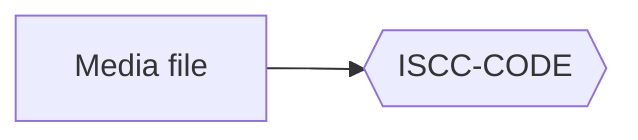

# Writing pages

Pages are Markdown files in `docs/`. Use these conventions, so that all ISCC sites work the same for readers and for
agents.

## Front matter

| Key           | Use                                                                                        |
| ------------- | ------------------------------------------------------------------------------------------ |
| `icon`        | The navigation icon, `lucide/<name>`. Each page must have one                              |
| `description` | One sentence for link previews and the `llms.txt` index. Without it, the page uses `site_description` |
| `title`       | The page title in the browser and in link previews, if it is different from the navigation label |
| `location`    | Makes the page a redirect to another URL. Use it for pages that moved                      |

```markdown
---
icon: lucide/rocket
description: Set up the theme for the documentation of an ISCC project
---
```

## Navigation icons

Each page shows an icon before its entry in the navigation. Select a name from the
[Lucide](https://lucide.dev/icons/) set. Zensical puts the icon into the page as SVG, so the icon adds no request.
Section labels in `nav` have no icon. Only pages have icons.

## For Coding Agents

The last page in the navigation of each ISCC site is "For Coding Agents". It is a short reference for AI agents
that work on the project or use it. It contains an architecture map, decision tables, constraints, side effects,
task recipes, change playbooks and common mistakes. It uses tables and code, not long text.

| Convention  | Value                                                    |
| ----------- | -------------------------------------------------------- |
| File        | `docs/for-coding-agents.md`                              |
| Nav entry   | `{ "For Coding Agents" = "for-coding-agents.md" }`, last |
| Icon        | `lucide/bot`                                             |

- Write the page with the `zensical-iscc:docs-for-agents` skill: `/zensical-iscc:docs-for-agents create`.
- Run the skill with `update` each time the public API, the command line or the configuration changes. Agents
    follow this page closely. If it is out of date, they make errors.
- Add this line to the `CLAUDE.md` or `AGENTS.md` of the project, so that coding sessions keep the page up to date:
    "After changing the public API, CLI or configuration, run the docs-for-agents skill with `update`."
- `zensical-iscc check` gives a warning if the page is missing or not in `nav`. With `--strict`, as in CI, the
    warning makes the build fail.
- `llms.txt` lists the page first, so agents that read the index start there.

The [For Coding Agents](for-coding-agents.md) page of this site is an example.

## Markdown for agents and people

`zensical-iscc build` writes the Markdown source of each page next to its HTML, without the front matter:

| File                  | Contents                                                                    |
| --------------------- | --------------------------------------------------------------------------- |
| `<page>/index.md`     | One page. "Copy page" and "View as Markdown" read it                        |
| `llms-full.txt`       | All pages, in navigation order                                              |
| `llms.txt`            | An index in the [llmstxt.org](https://llmstxt.org/) format: the agent page first, then all pages with their descriptions |

The head of each page links to its Markdown copy with `<link rel="alternate" type="text/markdown">`, so an agent
that gets the HTML can also find the source.

Write links between pages as usual, to the `.md` file relative to the page. The build rewrites them in each copy
to point at the other page's copy, `../configuration/index.md` for example, and links to images and other files
at those files. In `llms-full.txt` they are relative to the site root. Links inside code stay as written, and
`zensical-iscc check` reports a link in a copy that points at nothing.

## Page components

The theme styles a lead paragraph, buttons for calls to action, audience cards and ISCC-UNIT labels.
[Components](components.md) shows each of them with its markup. Cards need the `md_in_html` extension.

## Images, badges and media

Pages load nothing from other domains, except Plausible and, if chat is on, iscc.ai.

- Keep images and badges in `docs/`. Do not link to images on other sites. Download shields.io badges one time and
    link to the copies.
- To show an image in a lightbox, put it in `<a class="glightbox" href="...">`. The theme loads its own copy of
    GLightbox, and only on pages with a lightbox.
- For a diagram, write a [Mermaid](#diagrams) block or use an SVG file.

[Command line](command-line.md#third-party-requests) lists the requests that the check cannot see.

## Diagrams

Write a diagram as a fenced `mermaid` block:

````markdown

````

The `custom_fences` entry of the reference configuration turns these blocks into diagrams:

```toml
[project.markdown_extensions.pymdownx.superfences]
custom_fences = [{ name = "mermaid", class = "mermaid" }]
```

The theme loads its own copy of Mermaid, and only on pages with a diagram. The diagrams take the theme colors in both
color schemes. [Components](components.md#diagrams) shows a flowchart and a sequence diagram. The Markdown copy of
the page keeps the block, so agents read the diagram source.
